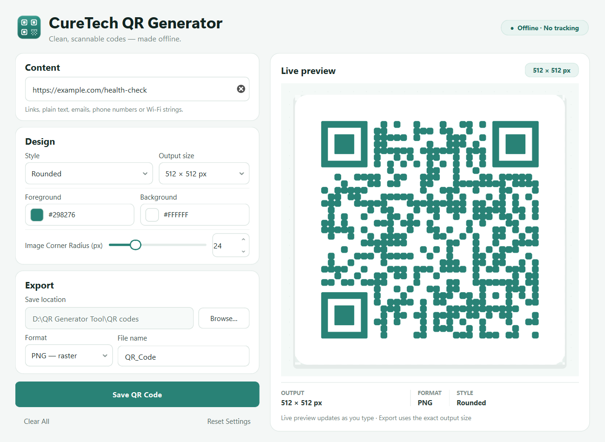
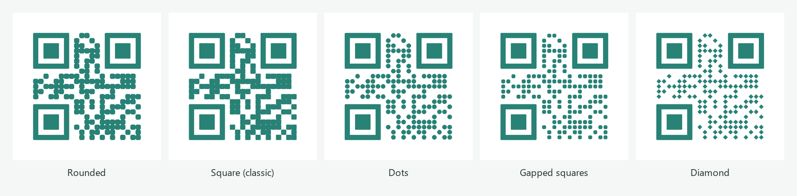

# CureTech QR Generator

A lightweight, entirely offline QR code generator for Windows 10 and 11 (64-bit).
It is built with Python 3.11+, PySide6, `qrcode` and Pillow, and ships as a
standalone PyInstaller application — no Python installation is required on the
target computer.



## Sharing with your team

**Yes — the packaged app works on other Windows PCs without Python installed.**
It uses the CPython runtime and every required library bundled inside its own
folder.

To send it to teammates:

1. Run `build.bat` to produce the shareable ZIP:
   `dist\CureTech_QR_Generator_Windows_x64.zip`.
2. Send that ZIP file (for example through Teams, OneDrive or a network share).
3. Each teammate extracts the whole ZIP, opens the extracted
   `CureTech_QR_Generator` folder and runs `CureTech_QR_Generator.exe`.

Requirements and notes:

- **Windows 10 or Windows 11, 64-bit.** It is not a 32-bit build.
- **Do not send only the `.exe`.** The application needs the `_internal` folder
  that sits beside it. The ZIP contains the complete portable folder.
- **No Python, no installer and no administrator rights are required.**
- **No internet connection is required** after downloading/extracting the app.
- **Settings are per Windows user** and are stored in
  `%APPDATA%\CureTech QR Generator\settings.json`. Each teammate starts with
  their own preferences.
- The default export folder is `QR codes` beside the application. If that
  location is not writable, the app falls back to `Documents\QR codes`. Users can
  choose any folder with **Browse…**.
- The current executable is **unsigned**. Windows SmartScreen or a corporate
  antivirus policy may warn on first launch or block it. Signing with a trusted
  code-signing certificate is recommended before distributing widely; see
  [Code signing](#code-signing). PyInstaller itself does not guarantee
  SmartScreen or antivirus approval.

## Highlights

- **Live preview** that updates as you type or change a setting, with a short
  debounce for text input.
- **Five QR styles** — Rounded, Square (classic), Dots, Gapped squares, Diamond.
  All styles are drawn natively and retain standard finder patterns.



- **Square or custom rectangular output** at 256, 512, 1024, 2048 px or any
  custom size from 64 to 4096 px.
- **Custom colors** using the native Windows color picker, with HEX values shown
  in the interface.
- **Image Corner Radius (px)** from 0 to 100 (default 24) that rounds only the
  four outer corners of the complete QR image. The module pattern and finder
  patterns never change. The maximum is automatically limited to a safe value
  for the selected canvas size.
- **PNG and SVG export**, preserving the selected style, colors and dimensions.
- **Safe, local settings** stored in a small JSON file; no registry writes,
  telemetry, networking or administrator rights.
- **High error correction (level H)** and a four-module quiet zone for reliable
  scanning.
- **Modern Windows UI** with DPI-aware rendering, tooltips and keyboard support.

## Getting the application

The built application is in:

```text
dist\CureTech_QR_Generator\CureTech_QR_Generator.exe
```

Run `CureTech_QR_Generator.exe` from that folder. Keep the `_internal` folder
beside the executable — PyInstaller's one-folder layout needs it. The ZIP in
`dist\CureTech_QR_Generator_Windows_x64.zip` is ready to hand to teammates.

## Using CureTech QR Generator

1. Type or paste a URL, email address, phone number, Wi-Fi string or any plain
   text into **Content**. The preview updates automatically.
2. Choose a **Style** and an **Output size**.
3. Pick **Foreground** and **Background** colors. If contrast is too low, a
   warning appears under the color buttons. Foreground and background cannot be
   identical.
4. Adjust **Image Corner Radius (px)** with the slider or the numeric field.
   This rounds the four corners of the complete QR image only. The QR module
   style stays unchanged. Values are automatically limited to a safe maximum for
   the selected canvas size.
5. Choose the save folder. The default is a **QR codes** folder beside the
   application; use **Browse…** to select another folder.
6. Choose **PNG** or **SVG**, edit the file name if you like, and click
   **Save QR Code**. The correct extension is added automatically. If a file
   with the same name already exists, you will be asked before it is replaced.
7. After saving, use **Open folder** in the confirmation dialog to open the
   destination in Explorer.

**Clear All** clears the text. **Reset Settings** restores the default design and
export options while keeping the current text. `Ctrl+S` saves the QR code.

### Output notes

- PNG exports are written at exactly the requested width and height. The area
  outside the rounded image corners is transparent (RGBA PNG). For a non-square
  custom canvas, the square QR code is centered on the background instead of
  being distorted.
- SVG exports use the same artboard dimensions and are made of native vector
  shapes. The outer corners are clipped with a proper `<clipPath>` and a rounded
  background rectangle for broad renderer compatibility. They contain no
  external references and open correctly in browsers and vector editors.
- `qrcode` is used with **error correction level H** and a four-module quiet
  zone. Keep the quiet zone and strong contrast if you place the PNG/SVG into
  another design.

## Settings and privacy

Appearance and export preferences are stored at:

```text
%APPDATA%\CureTech QR Generator\settings.json
```

The file stores the style, output size, colors, radius, export format, file name
and save location. **The URL/text you type is never written to disk.** There are
no accounts, telemetry, update checks, or network requests.

## Development setup

Requirements: Windows 10 or 11 (64-bit) and Python 3.11 or newer.

```bat
py -3.11 -m venv .venv
.venv\Scripts\activate
python -m pip install -r requirements-dev.txt
python main.py
```

Runtime dependencies are in `requirements.txt`; build and test dependencies are
in `requirements-build.txt` and `requirements-dev.txt`.

### Tests

```bat
python -m pytest
```

The test suite covers QR generation for every style, scannability (using
`zxing-cpp`), outer-corner transparency in PNG and SVG, unchanged QR modules at
different image radii, PNG/SVG exports, custom dimensions, settings validation
and the main UI flows. UI tests use the Qt offscreen platform. Optional test-only
packages are listed in `requirements-dev.txt`; they are not bundled into the
application.

## Building the Windows executable

Double-click `build.bat`, or run it from a terminal:

```bat
build.bat
```

It performs these steps:

1. Checks for Python 3.11+ (and uses `.venv` automatically when present).
2. Installs/verifies the build requirements.
3. Removes old build, distribution and spec artifacts.
4. Runs PyInstaller with the custom icon, version resource and Windows manifest.
5. Writes `dist\CureTech_QR_Generator\CureTech_QR_Generator.exe` with a portable
   `QR codes` folder.
6. Creates the shareable ZIP
   `dist\CureTech_QR_Generator_Windows_x64.zip`.

The build uses `--onedir` (one folder), `--windowed` (no console window) and
disables UPX compression to avoid suspicious binary packing. It excludes modules
the app does not use, including NumPy.

### Producing a single-file EXE

Copy `build.bat` and change `--onedir` to `--onefile`. PyInstaller will then
produce `dist\CureTech_QR_Generator.exe` instead of a folder. A one-file build
extracts its runtime to a temporary directory on each launch, so it starts more
slowly and is often more likely to trigger antivirus heuristics than a
one-folder build. The one-folder build is the recommended distribution.

### Customizing application metadata

Edit `version_info.txt` before building to set your own publisher and product
information:

```python
StringStruct('CompanyName', 'Your Company Name'),
StringStruct('LegalCopyright', 'Copyright (c) 2026 Your Company Name'),
...
```

Version numbers in `version_info.txt`, `src/__init__.py` and the window metadata
should be kept in sync. The manifest in `app.manifest` requests `asInvoker`
(no administrator rights), Per-Monitor V2 DPI awareness and no unnecessary
privileges.

## Code signing

PyInstaller alone does **not** guarantee that Windows Defender or SmartScreen will
trust the executable. A code-signing certificate from a publicly trusted
certificate authority and an established publisher reputation are the
recommended way to reduce warnings. Unsigned files can still be flagged even
when they contain no malicious code.

1. Obtain an Authenticode code-signing certificate (an EV certificate is
   preferable for publisher reputation) and install the certificate in the
   Windows certificate store.
2. Install the Windows SDK so `signtool.exe` is available.
3. Sign the built executable with SHA-256 and a trusted timestamp:

```bat
signtool sign /fd SHA256 /td SHA256 /tr http://timestamp.digicert.com /a "dist\CureTech_QR_Generator\CureTech_QR_Generator.exe"
```

4. Verify the signature:

```bat
signtool verify /pa /v "dist\CureTech_QR_Generator\CureTech_QR_Generator.exe"
```

Sign the final executable *after* building it, and re-sign after every rebuild.
Never claim that a signature or PyInstaller guarantees SmartScreen approval;
reputation is earned over time and may require an EV certificate or Microsoft
Trusted Signing.

## Security and antivirus considerations

This project follows conservative desktop-software practices:

- Standard, widely used Python packages only.
- No obfuscation, UPX packing, process injection or privilege escalation.
- No administrator manifest, registry changes, services or scheduled tasks.
- No network access, telemetry, downloaders or hidden communication.
- Stable application name, icon and company/file version metadata.
- One clear executable entry point for a transparent, inspectable one-folder
  build.

If a scanner flags the unsigned executable, submit it for analysis and sign
future releases with a trusted certificate. Do not distribute modified builds
without re-testing and re-signing them.

## Project structure

```text
CureTech QR Generator/
├── main.py                  # application entry point
├── requirements.txt         # runtime dependencies
├── requirements-build.txt   # PyInstaller build dependencies
├── requirements-dev.txt     # tests and optional scan verification
├── build.bat                # Windows build script (also creates the ZIP)
├── version_info.txt         # Windows EXE version metadata
├── app.manifest             # asInvoker + Per-Monitor V2 DPI manifest
├── app.ico                  # application icon (generated)
├── README.md
├── src/
│   ├── __init__.py
│   ├── ui.py                # PySide6 UI, preview, UI threads
│   ├── qr_engine.py         # QR matrix, raster painter and native SVG
│   ├── exporters.py         # file naming and export helpers
│   ├── settings.py          # local JSON preferences
│   ├── styles.py            # palette and Qt stylesheet
│   └── paths.py             # development / frozen resource paths
├── assets/icons/            # icon and combo/spin chevrons
├── tools/
│   ├── make_icon.py         # reproducible icon generator
│   └── take_screenshot.py   # documentation screenshot helper
├── tests/                   # pytest suite
├── docs/screenshot.png
├── QR codes/                # default export location in development
└── dist/                    # generated PyInstaller output and team ZIP
```

## Tested environment

- Windows 11, 64-bit
- Python 3.12
- PySide6 Essentials 6.12
- qrcode 8.2
- Pillow 13.0
- PyInstaller 6.22

Generated codes were verified with the ZXing decoder across all five styles at
256 × 256, 512 × 512 and 1024 × 1024, as well as SVG output rendered through Qt.
The packaged application was also launched, used to save a PNG, decoded, and
closed cleanly. For final verification before distribution, scan printed or
on-screen exports with a physical smartphone QR scanner as well.
